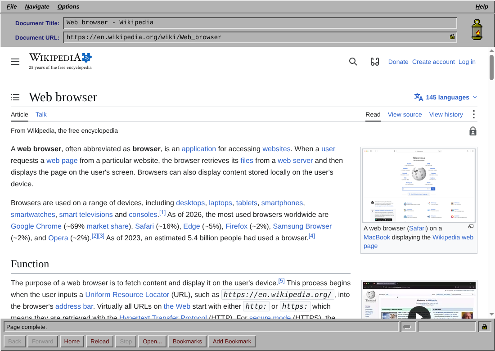

# Lantern

Lantern is a small desktop web browser with a late-1990s look: chunky gray
bevels, big icon-over-label buttons and a pixel-art lantern that flickers while
pages load. Pages are rendered by real Chromium through the
[Chromium Embedded Framework](https://bitbucket.org/chromiumembedded/cef) (CEF),
driven from Rust with the [`cef`](https://github.com/tauri-apps/cef-rs) crate.

v1 is deliberately small: one window, one tab, and popups open in the same view.
It can also make the modern web look like the '90s: see [Retro looks](#retro-looks).

## Download

Get the latest build for your platform from
[Releases](https://github.com/chrissnyder2337/thebrowser/releases/latest):

| Platform | Download |
|---|---|
| Windows (x86_64) | [lantern-windows-x86_64.zip](https://github.com/chrissnyder2337/thebrowser/releases/latest/download/lantern-windows-x86_64.zip) |
| macOS (Apple silicon) | [lantern-macos-arm64.zip](https://github.com/chrissnyder2337/thebrowser/releases/latest/download/lantern-macos-arm64.zip) |
| Linux (x86_64) | [lantern-linux-x86_64.tar.gz](https://github.com/chrissnyder2337/thebrowser/releases/latest/download/lantern-linux-x86_64.tar.gz) |

Each release also has a `SHA256SUMS.txt` to verify the downloads.

- **Windows:** unzip and run `lantern\lantern.exe`.
- **macOS:** unzip and move `Lantern.app` to Applications. The app is only
  ad-hoc signed, not notarized, so macOS blocks it the first time. Either run
  `xattr -dr com.apple.quarantine /Applications/Lantern.app`, or try to open it
  once and then click **Open Anyway** in System Settings → Privacy & Security.
  If macOS says the app "is damaged and can't be opened" (older builds
  weren't signed at all), run the `xattr` command above; if it still
  won't start, also run `codesign --force --deep --sign - /Applications/Lantern.app`.
- **Linux:** `tar xzf lantern-linux-x86_64.tar.gz && ./lantern/lantern`. If it
  exits with a sandbox error (some distributions restrict the user namespaces
  Chromium's sandbox uses), give the bundled helper its setuid bit with
  `sudo chown root:root lantern/chrome-sandbox && sudo chmod 4755 lantern/chrome-sandbox`.

## Using Lantern

| Action | Linux / Windows | macOS |
|---|---|---|
| Focus the URL field | Ctrl+L | Cmd+L |
| Back / Forward | Alt+Left / Alt+Right | Alt+Left / Alt+Right, Cmd+[ / Cmd+] |
| Reload | F5, Ctrl+R | F5, Cmd+R |
| Stop (while loading) | Esc | Esc |
| Bookmark this page | Ctrl+D | Cmd+D |
| Start page | Alt+Home | Alt+Home |

### Retro looks

The **Retro ▾** button at the end of the toolbar opens a menu of 1990s looks
that Lantern gives every web page:

| Look | What you get |
|---|---|
| GeoCities homepage (1998) | Starfield background, lime Comic Sans, rainbow headings, blinking links, ridged image borders, and a bottom bar with an UNDER CONSTRUCTION sign, a "Welcome!" marquee and a hit counter. A sparkle trail follows the mouse. |
| Early web (1995) | The site's own style sheets are switched off, so the page shows as plain HTML: gray background, Times, blue and purple underlined links. A footer adds a "best viewed with" line, a hit counter and a last-updated date. |
| Web portal (1997) | The page is squeezed into a 760px column (it has to fit 800x600) of small Arial on white, with headings on colored bars. A LanternNet header has a search box, a channel bar and a blinking 468x60 banner ad, and there's a copyright footer. Sticky headers go back into the page flow. |

The menu also turns on a **Flash-style splash intro**: entering a site shows a
black screen with the site's name zooming in over a spinning ring, a
"LOADING..." bar and an ENTER SITE button (or SKIP INTRO). It plays once per
site, not on every page.

<table>
  <tr>
    <td width="50%"> <b>GeoCities homepage (1998)</b></td>
    <td width="50%"> <b>Early web (1995)</b></td>
  </tr>
  <tr>
    <td width="50%"> <b>Web portal (1997)</b></td>
    <td width="50%"> <b>Flash-style splash intro</b></td>
  </tr>
</table>

The screenshots show the Wikipedia article on
[GeoCities](https://en.wikipedia.org/wiki/GeoCities) (CC BY-SA 4.0).

The button stays pressed in while a look is on. Choices are saved in
`settings.txt` and can also be changed on the settings page (**Retro
settings...** in the menu, or `lantern:settings`). Lantern's own pages (start
page, bookmarks, settings) keep their look.

The URL field accepts full URLs (`http`, `https`, `file`, `about`, `data`,
`view-source`), bare host names (`example.com`, `localhost:8080`, which get
`https://`) and anything else as a DuckDuckGo search. `lantern:home`,
`lantern:bookmarks`, `lantern:settings` and `lantern:about` open the internal pages. Clicking the
lantern opens the About page.

### Browser UI modes

The toolbar and status bar can take on the layout of other 1990s browsers.
Pick one from **Retro ▾ → Browser UI**, from a mode's **Options** menu, or
press **Ctrl+Shift+M** (**Cmd+Shift+M** on a Mac) in any mode. `--ui=<mode>`
picks one for a single run. More modes are on the way: see
[docs/ui-modes/](docs/ui-modes/).

- **Lantern (default)**: Lantern's own toolbar.
- **Workstation (1993)**: a Motif menu bar, Document Title and Document URL
  fields, and a row of text buttons under the page, modelled on NCSA Mosaic
  for X.

Pages can follow the mode too, picked under **Browser UI**: as their sites
made them, with the mode's browser defaults (a grey page and Times on plain
pages that have no style sheets of their own; the default), or in the
mode's era look (a full retro look). A retro look you pick yourself always
wins.

Product names are trademarks of their owners. Lantern isn't affiliated with
or endorsed by them; its icons and artwork are its own.

### Dial-up simulator

Lantern can make the Web feel like 1998 again. Open **Settings** by clicking the
little modem in the status bar (or type `lantern:settings`), pick a mode and a
modem speed (14.4K, 28.8K, 33.6K or 56K), and press **Save**:

- **Slow images**: pages and text arrive at full speed, but every picture starts
  hidden and paints in from the top, a few lines at a time. Its speed comes from
  the image's real size where the browser reports it, two downloads at a time
  sharing the modem's bandwidth.
- **Slow network**: everything the page loads goes through Chromium's network
  emulation at real modem throughput and latency (56K is about 5.5 KB/s with
  150 ms round trips), so text trickles in, images arrive last and big sites
  take minutes.

While the simulator is on, the status bar shows the modem speed. It only affects
the page view, never the toolbar, and the setting is remembered between runs.

### Where data lives

| | Bookmarks | Profile (cookies, logins, cache) |
|---|---|---|
| macOS | `~/Library/Application Support/Lantern/bookmarks.tsv` | `…/Lantern/cache` |
| Windows | `%APPDATA%\Lantern\bookmarks.tsv` | `%APPDATA%\Lantern\cache` |
| Linux | `$XDG_CONFIG_HOME/lantern/bookmarks.tsv` (default `~/.config/lantern`) | `…/lantern/cache` |

Settings (the dial-up simulator and the retro looks) live in `settings.txt` next
to the bookmarks, as `key=value` lines.

Bookmarks are plain text, one `title<TAB>url` per line, so you can edit the file
by hand while Lantern is closed. A few defaults are written on first run.

## Contributing

To build Lantern from source, run its tests or cut a release, see
[docs/development.md](docs/development.md). How it's put together (the views,
the chrome pages' channel to Rust, the retro looks engine and the source
layout) is in [docs/architecture.md](docs/architecture.md).

## Credits and license

Lantern is available under the [Apache-2.0](LICENSE-APACHE) or [MIT](LICENSE-MIT) license, at
your option.

- [Chromium Embedded Framework](https://bitbucket.org/chromiumembedded/cef), BSD license.
- [cef-rs](https://github.com/tauri-apps/cef-rs) by the Tauri team, Apache-2.0 or MIT. Lantern's
  platform glue (`main.rs`, `win.rs`, the macOS helper and application classes, `build.rs`,
  `resources/mac/English.lproj/MainMenu.xib`) is adapted from its `cefsimple` example.
- Chromium and its third-party components, under their respective licenses.
