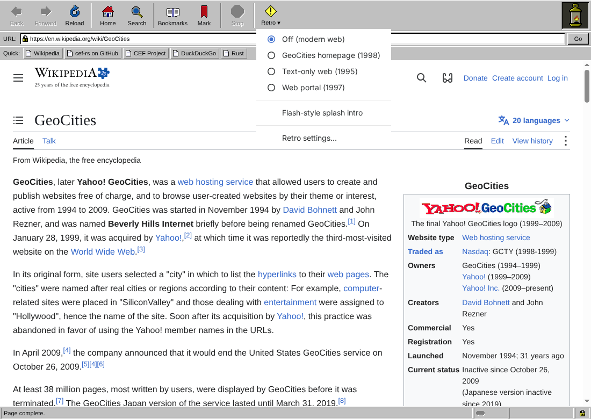
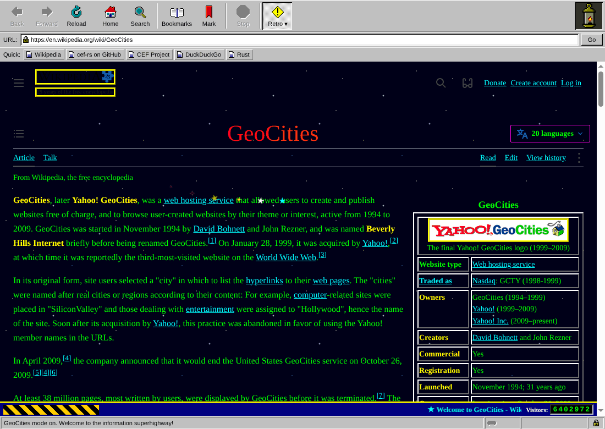
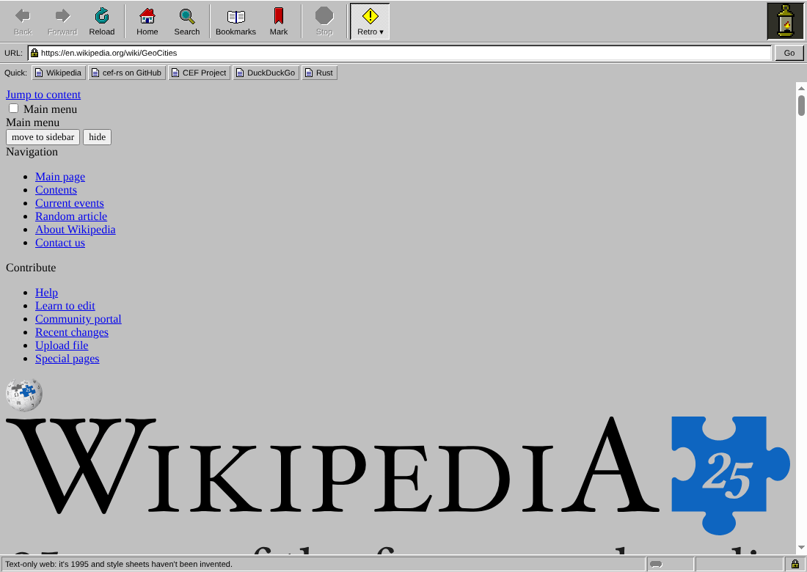
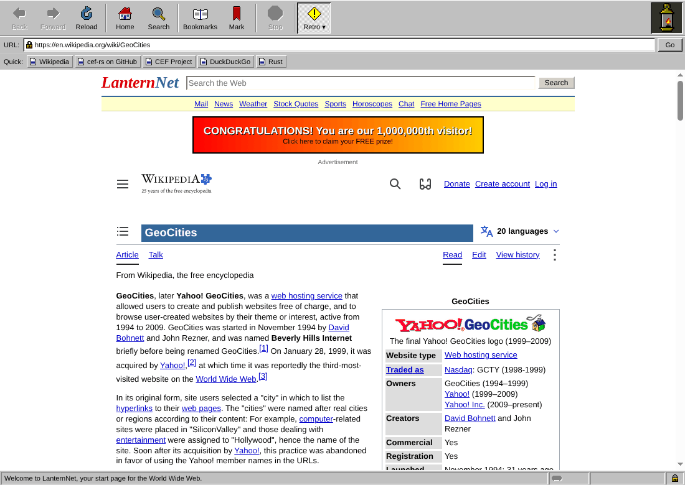
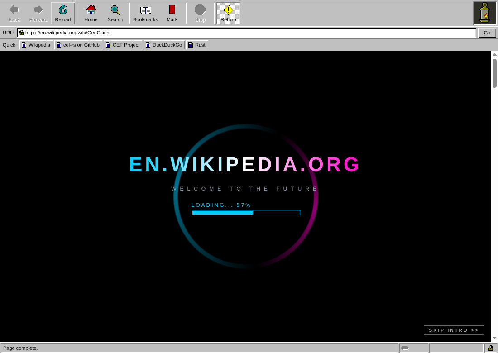

# Lantern

[](https://github.com/chrissnyder2337/thebrowser/actions/workflows/ci.yml)

Lantern is a small desktop web browser with a late-1990s look: chunky gray
bevels, big icon-over-label buttons and a pixel-art lantern that flickers while
pages load. Pages are rendered by real Chromium through the
[Chromium Embedded Framework](https://bitbucket.org/chromiumembedded/cef) (CEF),
driven from Rust with the [`cef`](https://github.com/tauri-apps/cef-rs) crate.


v1 is deliberately small: one window, one tab, and popups open in the same view.
It can also make the modern web look like the '90s: see [Retro looks](#retro-looks).

## Download

Get the latest build for your platform from
[Releases](https://github.com/chrissnyder2337/thebrowser/releases/latest):

| Platform | Download |
|---|---|
| Windows (x86_64) | [lantern-windows-x86_64.zip](https://github.com/chrissnyder2337/thebrowser/releases/latest/download/lantern-windows-x86_64.zip) |
| macOS (Apple silicon) | [lantern-macos-arm64.zip](https://github.com/chrissnyder2337/thebrowser/releases/latest/download/lantern-macos-arm64.zip) |
| Linux (x86_64) | [lantern-linux-x86_64.tar.gz](https://github.com/chrissnyder2337/thebrowser/releases/latest/download/lantern-linux-x86_64.tar.gz) |

Each release also has a `SHA256SUMS.txt` to verify the downloads.

- **Windows:** unzip and run `lantern\lantern.exe`.
- **macOS:** unzip and move `Lantern.app` to Applications. The app is only
  ad-hoc signed, not notarized, so macOS blocks it the first time. Either run
  `xattr -dr com.apple.quarantine /Applications/Lantern.app`, or try to open it
  once and then click **Open Anyway** in System Settings → Privacy & Security.
  If macOS says the app "is damaged and can't be opened" (older builds
  weren't signed at all), run the `xattr` command above; if it still
  won't start, also run `codesign --force --deep --sign - /Applications/Lantern.app`.
- **Linux:** `tar xzf lantern-linux-x86_64.tar.gz && ./lantern/lantern`. If it
  exits with a sandbox error (some distributions restrict the user namespaces
  Chromium's sandbox uses), give the bundled helper its setuid bit with
  `sudo chown root:root lantern/chrome-sandbox && sudo chmod 4755 lantern/chrome-sandbox`.

## Building and running

Lantern pins `cef = "=154.5.0"` (CEF 154.0.34, Chromium 154.0.8037.98). The
generated bindings track a specific CEF release, so upgrade the pin and the CEF
binaries together.

### 1. CEF binaries (optional, recommended)

The `cef-dll-sys` build script downloads CEF on its own, into its `OUT_DIR`. To
share one copy across builds, export it once and point `CEF_PATH` at it:

```sh
git clone --depth 1 https://github.com/tauri-apps/cef-rs.git
cargo run --manifest-path cef-rs/Cargo.toml -p export-cef-dir -- --force "$HOME/.local/share/cef"
export CEF_PATH="$HOME/.local/share/cef"
```

On Windows (PowerShell) use `$env:USERPROFILE/.local/share/cef` and
`$env:CEF_PATH=...`.

### 2. The bundling tool

`bundle-cef-app` builds Lantern and lays out a runnable app with the CEF files.
Install the version that matches the pinned crate:

```sh
cargo install cef --version "=154.5.0" --bin bundle-cef-app --locked
```

### 3. Build and run

**Linux**

```sh
bundle-cef-app lantern -o target/bundle            # add --release for a much smaller bundle
./target/bundle/lantern
```

The executable carries an `$ORIGIN` rpath, so it finds `libcef.so` next to itself.
Chromium refuses to run as root without `--no-sandbox`; as a normal user its own
sandbox works as usual.

**macOS**

```sh
bundle-cef-app lantern -o target/bundle -d Lantern -i org.example.lantern
open target/bundle/lantern.app
```

The bundle uses `lantern_helper` for CEF's subprocesses and copies
`resources/mac` (menu, strings, `lantern.icns`) into the app.

**Windows (PowerShell)**

```pwsh
bundle-cef-app lantern -o ./target/bundle
./target/bundle/lantern.exe
```

With the default `sandbox` feature the bundler builds the `cdylib` (entry point
`RunWinMain`) and pairs it with CEF's `bootstrap.exe`. Build with
`--no-default-features` for a plain executable. Icons are embedded by `build.rs`.

### Command-line options

- `--url=<address>`: open this instead of the start page. URL-bar rules apply,
  so `--url=example.com` works.
- `--retro=<look>`: use a retro look for this run without saving it (see below):
  `geocities`, `early-web`, `portal` or `off`. `--geocities` is short for
  `--retro=geocities`.

### Tests

```sh
cargo test --bin lantern
```

CI (`.github/workflows/ci.yml`) runs rustfmt, clippy, the unit tests and a
release bundle on Linux (uploaded as a build artifact), and builds on macOS and
Windows. It needs Rust 1.88 or newer.

The unit tests cover URL normalization, percent and HTML/JS escaping, the title
channel parser, template filling, bookmark and settings storage, the
retro script builder and the pixel-art sheets.

### Releasing

`Cargo.toml`'s version decides the release. There's no separate tagging step:

```sh
tools/bump-version.sh minor --push     # or patch, major, or an exact 1.4.0
```

The script bumps `Cargo.toml` and `Cargo.lock` on a `release/vX.Y.Z` branch
started from `origin/main`, commits it, pushes it, and opens a pull request
(with the GitHub CLI `gh`, if installed; otherwise it prints the link). Add
`--dry-run` to preview it, or leave out `--push` to push it yourself.

Merging that pull request publishes the release: `.github/workflows/release.yml`
sees that `vX.Y.Z` doesn't exist yet, builds Linux x86_64 (`.tar.gz`), macOS
arm64 (`.zip` of `Lantern.app`) and Windows x86_64 (`.zip`), creates the tag,
and publishes the bundles under fixed names (so the Download links above always
reach the newest release) with a `SHA256SUMS.txt` and generated notes.

- Pushing a tag by hand still works if it matches `Cargo.toml` at that commit.
  If not, the run stops with a "Tag does not match Cargo.toml" error and
  instructions.
- Running the Release workflow from the Actions tab builds the bundles as
  downloadable artifacts. Tick **publish** to release the version in
  `Cargo.toml` from that branch: useful to fill a release left without files.
- In Claude Code, `/release` (`.claude/skills/release/SKILL.md`) runs the whole
  process: picking the version from the commits, the bump PR, CI, merging, and
  checking the downloads.

The macOS app is ad-hoc signed (`codesign --sign -`) but not notarized, so
after downloading it, run `xattr -dr com.apple.quarantine Lantern.app` or allow
it under System Settings → Privacy & Security → Open Anyway.

## Using Lantern

| Action | Linux / Windows | macOS |
|---|---|---|
| Focus the URL field | Ctrl+L | Cmd+L |
| Back / Forward | Alt+Left / Alt+Right | Alt+Left / Alt+Right, Cmd+[ / Cmd+] |
| Reload | F5, Ctrl+R | F5, Cmd+R |
| Stop (while loading) | Esc | Esc |
| Bookmark this page | Ctrl+D | Cmd+D |
| Start page | Alt+Home | Alt+Home |

### Retro looks

The **Retro ▾** button at the end of the toolbar opens a menu of 1990s looks
that Lantern gives every web page:



| Look | What you get |
|---|---|
| GeoCities homepage (1998) | Starfield background, lime Comic Sans, rainbow headings, blinking links, ridged image borders, and a bottom bar with an UNDER CONSTRUCTION sign, a "Welcome!" marquee and a hit counter. A sparkle trail follows the mouse. |
| Early web (1995) | The site's own style sheets are switched off, so the page shows as plain HTML: gray background, Times, blue and purple underlined links. A footer adds a "best viewed with" line, a hit counter and a last-updated date. |
| Web portal (1997) | The page is squeezed into a 760px column (it has to fit 800x600) of small Arial on white, with headings on colored bars. A LanternNet header has a search box, a channel bar and a blinking 468x60 banner ad, and there's a copyright footer. Sticky headers go back into the page flow. |

The menu also turns on a **Flash-style splash intro**: entering a site shows a
black screen with the site's name zooming in over a spinning ring, a
"LOADING..." bar and an ENTER SITE button (or SKIP INTRO). It plays once per
site, not on every page.

<table>
  <tr>
    <td width="50%"><br><b>GeoCities homepage (1998)</b></td>
    <td width="50%"><br><b>Early web (1995)</b></td>
  </tr>
  <tr>
    <td width="50%"><br><b>Web portal (1997)</b></td>
    <td width="50%"><br><b>Flash-style splash intro</b></td>
  </tr>
</table>

The screenshots show the Wikipedia article on
[GeoCities](https://en.wikipedia.org/wiki/GeoCities) (CC BY-SA 4.0).

The button stays pressed in while a look is on. Choices are saved in
`settings.txt` and can also be changed on the settings page (**Retro
settings...** in the menu, or `lantern:settings`). Lantern's own pages (start
page, bookmarks, settings) keep their look.

How it works: `src/shell/retro.rs` runs `ui/retro/runtime.js`, together with
the look definitions in `ui/retro/`, in every frame of the content view when a
load starts and when it ends, and in all frames right away when the look
changes. The styles are constructed stylesheets (`adoptedStyleSheets`), which
page Content Security Policies don't block. They also go into the page's open
shadow trees (custom elements). Floating boxes like menus and cookie banners
that had a solid background keep a solid one, so they stay readable.
Decorations live in closed shadow roots so the page can't restyle them.
Everything is rechecked as the page changes, and switching back to Off takes
it all out again without a reload. The splash intro is `ui/retro/splash.js`;
it runs as the page starts loading, so it covers the load the way the
originals did. The Retro menu is a native CEF menu (`Window::show_menu`)
anchored under the button, because an HTML menu would be clipped to the
toolbar view.

The URL field accepts full URLs (`http`, `https`, `file`, `about`, `data`,
`view-source`), bare host names (`example.com`, `localhost:8080`, which get
`https://`) and anything else as a DuckDuckGo search. `lantern:home`,
`lantern:bookmarks`, `lantern:settings` and `lantern:about` open the internal pages. Clicking the
lantern opens the About page.

### Dial-up simulator

Lantern can make the Web feel like 1998 again. Open **Settings** by clicking the
little modem in the status bar (or type `lantern:settings`), pick a mode and a
modem speed (14.4K, 28.8K, 33.6K or 56K), and press **Save**:

- **Slow images**: pages and text arrive at full speed, but every picture starts
  hidden and paints in from the top, a few lines at a time. Its speed comes from
  the image's real size where the browser reports it, two downloads at a time
  sharing the modem's bandwidth.
- **Slow network**: everything the page loads goes through Chromium's network
  emulation at real modem throughput and latency (56K is about 5.5 KB/s with
  150 ms round trips), so text trickles in, images arrive last and big sites
  take minutes.

While the simulator is on, the status bar shows the modem speed. It only affects
the page view, never the toolbar, and the setting is remembered between runs.

### Where data lives

| | Bookmarks | Profile (cookies, logins, cache) |
|---|---|---|
| macOS | `~/Library/Application Support/Lantern/bookmarks.tsv` | `…/Lantern/cache` |
| Windows | `%APPDATA%\Lantern\bookmarks.tsv` | `%APPDATA%\Lantern\cache` |
| Linux | `$XDG_CONFIG_HOME/lantern/bookmarks.tsv` (default `~/.config/lantern`) | `…/lantern/cache` |

Settings (the dial-up simulator and the retro looks) live in `settings.txt` next
to the bookmarks, as `key=value` lines.

Bookmarks are plain text, one `title<TAB>url` per line, so you can edit the file
by hand while Lantern is closed. A few defaults are written on first run.

## How it works

One top-level CEF Views window holds three `BrowserView`s in a vertical box
layout, all using the Alloy runtime style:

```
┌──────────────────────────────────────────────┐
│ toolbar  (112 DIP, data: page from ui/)      │
├──────────────────────────────────────────────┤
│ content  (flex 1, the web page)              │
├──────────────────────────────────────────────┤
│ status   (24 DIP, data: page from ui/)       │
└──────────────────────────────────────────────┘
```

The toolbar and status bar are ordinary HTML pages, which is the same idea as
building browser UI with web tech on top of Chromium. They talk to Rust like this:

- **Chrome page → Rust.** The page sets its own `document.title` to
  `lantern|<seq>|<command>|<encodeURIComponent(arg)>`. The toolbar's display
  handler sees it in `on_title_change`, decodes it and acts on the content
  browser. Commands: `ready`, `back`, `forward`, `reload`, `stop`, `home`,
  `search`, `go`, `open`, `bookmark-add`, `bookmarks`, `about`, `retro-menu`.
- **Rust → chrome page.** `execute_java_script("lantern.update({...})")` pushes
  state (URL, nav buttons, loading, quick links; status text, progress, padlock).
- **Internal page → Rust.** The bookmarks, about and error pages link to
  `https://lantern.invalid/<action>?…`. The content view's `on_before_browse`
  handles these and cancels the navigation. `.invalid` is a reserved TLD, so
  these links can't collide with a real site.
- **Lockdown.** The toolbar and status views cancel every navigation except
  loading their own `data:` page, and they never open popups.

Each view has its own `Client`, which records the view's role (`Toolbar`,
`Content` or `Status`). Shell state lives in a thread-local `RefCell`, since
every callback runs on the CEF UI thread and CEF objects aren't `Send`.

Alloy style provides no browser UI of its own, so Lantern supplies the pieces
it needs: an error page (`on_load_error`, skipping `ERR_ABORTED`), a download
handler that shows the native save dialog, and popups redirected into the
content view.

### Source layout

```
src/main.rs, lib.rs, win.rs     entry points (from cefsimple; lib.rs/win.rs = Windows sandbox)
src/bin/lantern_helper.rs       macOS helper subprocess
src/mac/mod.rs                  NSApplication subclass + app delegate (from cefsimple)
src/shell/mod.rs                load_cef, run_main, CEF settings
src/shell/app.rs                App + BrowserProcessHandler, creates the window and views
src/shell/window.rs             window and BrowserView delegates (sizes, Alloy style, close)
src/shell/client.rs             per-role Client: display, load, life span, request, keyboard, download
src/shell/state.rs              Shell state, push helpers, UI-thread tasks
src/shell/commands.rs           title-channel commands, lantern.invalid actions, navigation
src/shell/pages.rs              data: URIs for chrome and internal pages
src/shell/art.rs                pixel-art text → inline SVG
src/shell/bookmarks.rs          bookmark TSV + per-OS data directory
src/shell/settings.rs           user settings (dial-up mode, modem speed profiles, retro look)
src/shell/dialup.rs             dial-up simulator: network emulation and the image pacer
src/shell/retro.rs              retro looks: the Retro menu and running ui/retro/*.js
src/shell/util.rs               percent/HTML/JS escaping, URL-bar normalization, tiny JSON
ui/toolbar.html, status.html    chrome pages (self-contained HTML/CSS/JS)
ui/retro/runtime.js             retro looks engine (sheets, shadow trees, floating boxes, rescans)
ui/retro/{geocities,early-web,portal}.js the looks
ui/retro/splash.js              Flash-style splash intro
ui/pages/*.html, common.css     internal page templates ({{PLACEHOLDER}} substitution)
ui/dialup-images.js             "slow images" pacer injected into content pages
ui/lantern.txt, icons.txt       pixel art: the lantern (5 frames) and the toolbar icons
ui/appicon/                     generated window icons
resources/mac, resources/win    bundle resources and generated .icns/.ico
tools/make_icons.py             regenerates all app icons from ui/lantern.txt
tools/bump-version.sh           bumps the version and opens the release pull request
.claude/skills/release/         Claude Code skill for cutting and debugging releases
```

### Pixel art

All artwork is original and drawn as text grids in `ui/lantern.txt` and
`ui/icons.txt`: a palette of `= <char> <#rrggbb>` lines, then `frame <name>`
blocks. Rust turns each frame into a `shape-rendering: crispEdges` SVG at build
time (disabled buttons get an embossed gray/white version). The throbber is a
4-frame strip animated with CSS `steps(4)`. After editing the lantern, run
`python3 tools/make_icons.py` (needs Pillow) to regenerate the PNG, `.icns` and
`.ico` files.

## Credits and license

Lantern is available under the [Apache-2.0](LICENSE-APACHE) or [MIT](LICENSE-MIT) license, at
your option.

- [Chromium Embedded Framework](https://bitbucket.org/chromiumembedded/cef), BSD license.
- [cef-rs](https://github.com/tauri-apps/cef-rs) by the Tauri team, Apache-2.0 or MIT. Lantern's
  platform glue (`main.rs`, `win.rs`, the macOS helper and application classes, `build.rs`,
  `resources/mac/English.lproj/MainMenu.xib`) is adapted from its `cefsimple` example.
- Chromium and its third-party components, under their respective licenses.
