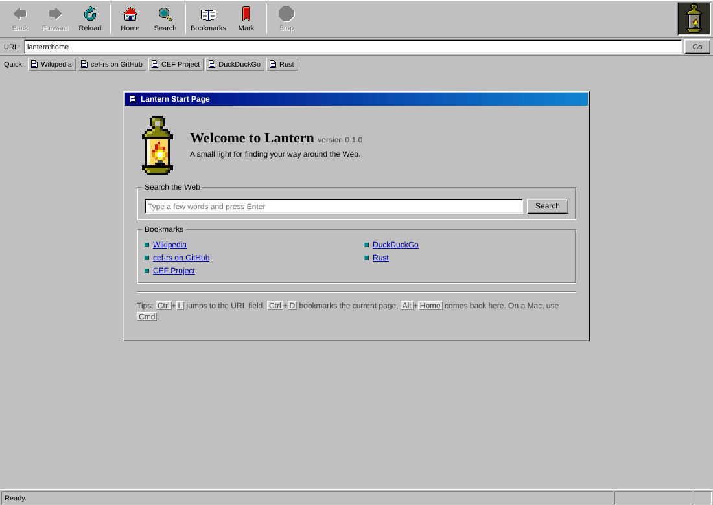

# Lantern

Lantern is a small desktop web browser with a late-1990s look: chunky gray
bevels, big icon-over-label buttons and a pixel-art lantern that flickers while
pages load. Pages are rendered by real Chromium through the
[Chromium Embedded Framework](https://bitbucket.org/chromiumembedded/cef) (CEF),
driven from Rust with the [`cef`](https://github.com/tauri-apps/cef-rs) crate.



v1 is deliberately small: one window, one tab, and popups open in the same view.

## Building and running

Lantern pins `cef = "=154.5.0"` (CEF 154.0.34, Chromium 154.0.8037.98). The
generated bindings track a specific CEF release, so upgrade the pin and the CEF
binaries together.

### 1. CEF binaries (optional, recommended)

The `cef-dll-sys` build script downloads CEF on its own, into its `OUT_DIR`. To
share one copy across builds, export it once and point `CEF_PATH` at it:

```sh
git clone --depth 1 https://github.com/tauri-apps/cef-rs.git
cargo run --manifest-path cef-rs/Cargo.toml -p export-cef-dir -- --force "$HOME/.local/share/cef"
export CEF_PATH="$HOME/.local/share/cef"
```

On Windows (PowerShell) use `$env:USERPROFILE/.local/share/cef` and
`$env:CEF_PATH=...`.

### 2. The bundling tool

`bundle-cef-app` builds Lantern and lays out a runnable app with the CEF files.
Install the version that matches the pinned crate:

```sh
cargo install cef --version "=154.5.0" --bin bundle-cef-app --locked
```

### 3. Build and run

**Linux**

```sh
bundle-cef-app lantern -o target/bundle            # add --release for a much smaller bundle
./target/bundle/lantern
```

The executable carries an `$ORIGIN` rpath, so it finds `libcef.so` next to itself.
Chromium refuses to run as root without `--no-sandbox`; as a normal user its own
sandbox works as usual.

**macOS**

```sh
bundle-cef-app lantern -o target/bundle -d Lantern -i org.example.lantern
open target/bundle/lantern.app
```

The bundle uses `lantern_helper` for CEF's subprocesses and copies
`resources/mac` (menu, strings, `lantern.icns`) into the app.

**Windows (PowerShell)**

```pwsh
bundle-cef-app lantern -o ./target/bundle
./target/bundle/lantern.exe
```

With the default `sandbox` feature the bundler builds the `cdylib` (entry point
`RunWinMain`) and pairs it with CEF's `bootstrap.exe`. Build with
`--no-default-features` for a plain executable. Icons are embedded by `build.rs`.

### Command-line options

- `--url=<address>`: open this instead of the start page. URL-bar rules apply,
  so `--url=example.com` works.

### Tests

```sh
cargo test --bin lantern
```

The unit tests cover URL normalization, percent and HTML/JS escaping, the title
channel parser, template filling, bookmark storage and the pixel-art sheets.

## Using Lantern

| Action | Linux / Windows | macOS |
|---|---|---|
| Focus the URL field | Ctrl+L | Cmd+L |
| Back / Forward | Alt+Left / Alt+Right | Alt+Left / Alt+Right, Cmd+[ / Cmd+] |
| Reload | F5, Ctrl+R | F5, Cmd+R |
| Stop (while loading) | Esc | Esc |
| Bookmark this page | Ctrl+D | Cmd+D |
| Start page | Alt+Home | Alt+Home |

The URL field accepts full URLs (`http`, `https`, `file`, `about`, `data`,
`view-source`), bare host names (`example.com`, `localhost:8080`, which get
`https://`) and anything else as a DuckDuckGo search. `lantern:home`,
`lantern:bookmarks` and `lantern:about` open the internal pages. Clicking the
lantern opens the About page.

### Where data lives

| | Bookmarks | Profile (cookies, logins, cache) |
|---|---|---|
| macOS | `~/Library/Application Support/Lantern/bookmarks.tsv` | `…/Lantern/cache` |
| Windows | `%APPDATA%\Lantern\bookmarks.tsv` | `%APPDATA%\Lantern\cache` |
| Linux | `$XDG_CONFIG_HOME/lantern/bookmarks.tsv` (default `~/.config/lantern`) | `…/lantern/cache` |

Bookmarks are plain text, one `title<TAB>url` per line, so you can edit the file
by hand while Lantern is closed. A few defaults are written on first run.

## How it works

One top-level CEF Views window holds three `BrowserView`s in a vertical box
layout, all using the Alloy runtime style:

```
┌──────────────────────────────────────────────┐
│ toolbar  (112 DIP, data: page from ui/)      │
├──────────────────────────────────────────────┤
│ content  (flex 1, the web page)              │
├──────────────────────────────────────────────┤
│ status   (24 DIP, data: page from ui/)       │
└──────────────────────────────────────────────┘
```

The toolbar and status bar are ordinary HTML pages, which is the same idea as
building browser UI with web tech on top of Chromium. They talk to Rust like this:

- **Chrome page → Rust.** The page sets its own `document.title` to
  `lantern|<seq>|<command>|<encodeURIComponent(arg)>`. The toolbar's display
  handler sees it in `on_title_change`, decodes it and acts on the content
  browser. Commands: `ready`, `back`, `forward`, `reload`, `stop`, `home`,
  `search`, `go`, `open`, `bookmark-add`, `bookmarks`, `about`.
- **Rust → chrome page.** `execute_java_script("lantern.update({...})")` pushes
  state (URL, nav buttons, loading, quick links; status text, progress, padlock).
- **Internal page → Rust.** The bookmarks, about and error pages link to
  `https://lantern.invalid/<action>?…`. The content view's `on_before_browse`
  handles these and cancels the navigation. `.invalid` is a reserved TLD, so
  these links can't collide with a real site.
- **Lockdown.** The toolbar and status views cancel every navigation except
  loading their own `data:` page, and they never open popups.

Each view has its own `Client`, which records the view's role (`Toolbar`,
`Content` or `Status`). Shell state lives in a thread-local `RefCell`, since
every callback runs on the CEF UI thread and CEF objects aren't `Send`.

Alloy style provides no browser UI of its own, so Lantern supplies the pieces
it needs: an error page (`on_load_error`, skipping `ERR_ABORTED`), a download
handler that shows the native save dialog, and popups redirected into the
content view.

### Source layout

```
src/main.rs, lib.rs, win.rs     entry points (from cefsimple; lib.rs/win.rs = Windows sandbox)
src/bin/lantern_helper.rs       macOS helper subprocess
src/mac/mod.rs                  NSApplication subclass + app delegate (from cefsimple)
src/shell/mod.rs                load_cef, run_main, CEF settings
src/shell/app.rs                App + BrowserProcessHandler, creates the window and views
src/shell/window.rs             window and BrowserView delegates (sizes, Alloy style, close)
src/shell/client.rs             per-role Client: display, load, life span, request, keyboard, download
src/shell/state.rs              Shell state, push helpers, UI-thread tasks
src/shell/commands.rs           title-channel commands, lantern.invalid actions, navigation
src/shell/pages.rs              data: URIs for chrome and internal pages
src/shell/art.rs                pixel-art text → inline SVG
src/shell/bookmarks.rs          bookmark TSV + per-OS data directory
src/shell/util.rs               percent/HTML/JS escaping, URL-bar normalization, tiny JSON
ui/toolbar.html, status.html    chrome pages (self-contained HTML/CSS/JS)
ui/pages/*.html, common.css     internal page templates ({{PLACEHOLDER}} substitution)
ui/lantern.txt, icons.txt       pixel art: the lantern (5 frames) and the toolbar icons
ui/appicon/                     generated window icons
resources/mac, resources/win    bundle resources and generated .icns/.ico
tools/make_icons.py             regenerates all app icons from ui/lantern.txt
```

### Pixel art

All artwork is original and drawn as text grids in `ui/lantern.txt` and
`ui/icons.txt`: a palette of `= <char> <#rrggbb>` lines, then `frame <name>`
blocks. Rust turns each frame into a `shape-rendering: crispEdges` SVG at build
time (disabled buttons get an embossed gray/white version). The throbber is a
4-frame strip animated with CSS `steps(4)`. After editing the lantern, run
`python3 tools/make_icons.py` (needs Pillow) to regenerate the PNG, `.icns` and
`.ico` files.

## Credits and license

Lantern is available under the Apache-2.0 or MIT license, at your option.

- [Chromium Embedded Framework](https://bitbucket.org/chromiumembedded/cef), BSD license.
- [cef-rs](https://github.com/tauri-apps/cef-rs) by the Tauri team, Apache-2.0 or MIT. Lantern's
  platform glue (`main.rs`, `win.rs`, the macOS helper and application classes, `build.rs`,
  `resources/mac/English.lproj/MainMenu.xib`) is adapted from its `cefsimple` example.
- Chromium and its third-party components, under their respective licenses.
