# 1990s web browsers: a screenshot catalog

<!-- Generated from catalog.json by render.py. Edit those, not this file. -->

A reference catalog of the web browsers people used in the 1990s, version by version, with screenshots, for planning Lantern's retro looks. Dates and facts come from English Wikipedia (October 2026); each browser links to its article.

## Rules for using this material

- **Reference only.** Lantern's branding rule (see `.claude/skills/steward/SKILL.md`) still applies: don't copy these browsers' names, logos, icons, throbber animations, wording or layout signatures. Use them to understand the era (bevels, button sizes, toolbars, status bars, colours, fonts), then design something original.
- **Images in `images/`** come from Wikimedia Commons, where each is marked public domain or freely licensed (CC0, CC BY-SA, GPL, Free Art License). Each one is credited below and in `catalog.json`. Reusing a CC BY-SA, GPL or FAL image means keeping its credit and licence.
- **A free licence covers the screenshot, not everything in it.** The interface shown (icons, logos, artwork) may still belong to the software's maker. Don't ship these images, or pieces of them, in Lantern.
- **Fair-use screenshots are linked, not copied.** Most early Internet Explorer, Opera and other proprietary browser screenshots exist only as non-free files on Wikipedia. Fair use covers Wikipedia's use of them, not redistribution from this repository.

## At a glance

| Browser | First release | Platforms | In this repo | Linked |
| --- | --- | --- | --- | --- |
| [WorldWideWeb (later Nexus)](#worldwideweb) | 1990-12-25 | NeXTSTEP | 1 | 0 |
| [Line Mode Browser](#line-mode) | 1991-05-14 | Any terminal (cross-platform via libwww) | 1 | 0 |
| [Lynx](#lynx) | 1992 | Unix-like, DOS, Windows, VMS | 1 | 0 |
| [ViolaWWW](#violawww) | 1992-03-09 | Unix (X11) | 0 | 1 |
| [Erwise](#erwise) | 1992-04-15 | Unix (X11) | 0 | 1 |
| [tkWWW](#tkwww) | 1992-07-25 | Unix (Tcl/Tk) | 1 | 0 |
| [MacWWW (Samba)](#macwww) | 1992-12 | Classic Mac OS | 0 | 1 |
| [NCSA Mosaic](#ncsa-mosaic) | 1993-01-23 | Unix (X11/Motif), Windows, Classic Mac OS | 1 | 1 |
| [Cello](#cello) | 1993-06-08 | Windows 3.1, OS/2 | 0 | 2 |
| [IBM WebExplorer](#ibm-webexplorer) | 1994 | OS/2 | 0 | 1 |
| [Netscape (Mosaic Netscape, Navigator, Communicator)](#netscape) | 1994-10-13 | Windows 3.1/95/NT, Classic Mac OS, Unix (many) | 8 | 4 |
| [Arena](#arena) | 1994-10-24 | Unix (X11), Linux, NeXT | 1 | 0 |
| [SlipKnot](#slipknot) | 1994-11 | Windows 3.1 | 0 | 1 |
| [Opera (MultiTorg Opera)](#opera) | 1995 | Windows, later others | 0 | 2 |
| [Internet Explorer](#internet-explorer) | 1995-08-24 | Windows 3.1/95/98/NT, Classic Mac OS, Solaris and HP-UX | 0 | 7 |
| [Grail](#grail) | 1995-11 | Unix, Windows, Mac (Python/Tk) | 0 | 1 |
| [Oracle PowerBrowser](#oracle-powerbrowser) | 1996 | Windows | 1 | 0 |
| [IBrowse](#ibrowse) | 1996-07-28 | AmigaOS | 0 | 1 |
| [WebTV](#webtv) | 1996-09-18 | Set-top box on a TV | 1 | 0 |
| [Arachne](#arachne) | 1996-12-22 | DOS, later Linux | 2 | 0 |
| [HotJava](#hotjava) | 1997-03-24 | Solaris, Windows, any Java platform | 1 | 0 |
| [Links](#links) | 1999 | Unix-like, OS/2, DOS, Windows | 1 | 0 |
| [iCab](#icab) | 1999-02-17 | Classic Mac OS | 0 | 0 |

## WorldWideWeb (later Nexus)

Tim Berners-Lee, CERN · NeXTSTEP · [Wikipedia](https://en.wikipedia.org/wiki/WorldWideWeb)

**Look:** A NeXTSTEP application: commands live in the vertical NeXT menu, every document opens in its own window, and pages can be edited as well as read.

| Version | Released | Notes |
| --- | --- | --- |
| first version | 1990-12-25 | The first web browser, which was also an editor. |

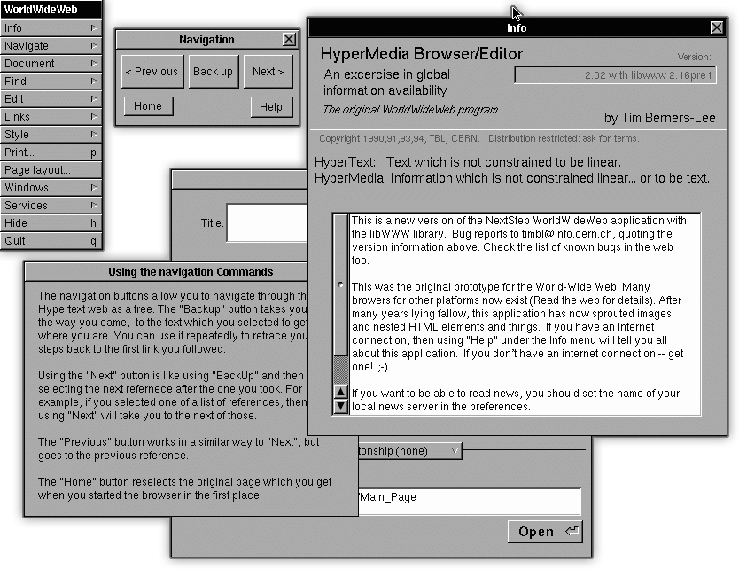

*NeXTSTEP build:* Browser windows and menu on NeXTSTEP.  
Credit: Ck_mpk · [Public domain](https://commons.wikimedia.org/wiki/File:WorldWideWeb.1.png) · [source](https://commons.wikimedia.org/wiki/File:WorldWideWeb.1.png)

Try it: [CERN's 2019 rebuild, runs in a modern browser](https://worldwideweb.cern.ch/)

## Line Mode Browser

CERN · Any terminal (cross-platform via libwww) · [Wikipedia](https://en.wikipedia.org/wiki/Line_Mode_Browser)

**Look:** Plain text for teletype-style terminals. Links are numbered in square brackets and you type the number (or a command) at a prompt below the page.

| Version | Released | Notes |
| --- | --- | --- |
| 0.7 | 1991-05-14 | First release listed in the change history. |

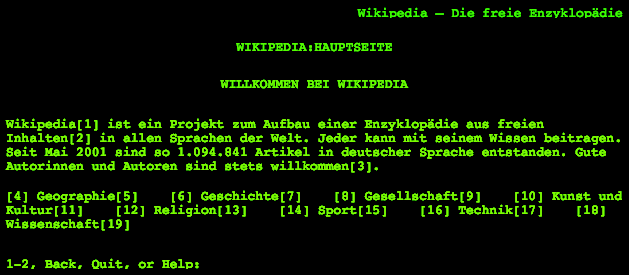

*later build:* A modern page rendered as numbered-link text.  
Credit: Raphael Kirchner · [CC BY-SA 4.0](https://creativecommons.org/licenses/by-sa/4.0) · [source](https://commons.wikimedia.org/wiki/File:Line_Mode_Browser_Wikipedia.png)

## Lynx

University of Kansas; later Thomas Dickey · Unix-like, DOS, Windows, VMS · [Wikipedia](https://en.wikipedia.org/wiki/Lynx_(web_browser))

**Look:** Full-screen text browser: links are highlighted and chosen with the arrow keys, with a status line and key hints at the bottom of the screen.

| Version | Released | Notes |
| --- | --- | --- |
| first release | 1992 | Still maintained; the interface has barely changed since the 1990s. |

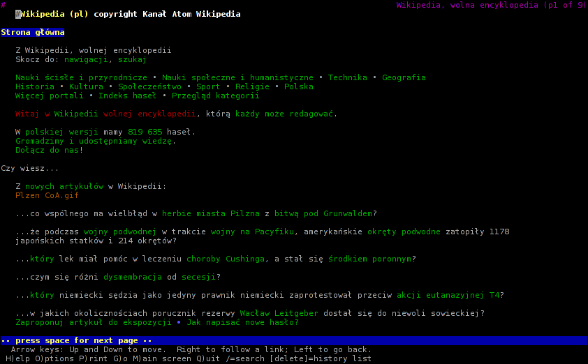

*2.8.8 (2010s):* The full-screen text interface, unchanged in style from the 1990s releases.  
Credit: Shah-al · [CC0](http://creativecommons.org/publicdomain/zero/1.0/deed.en) · [source](https://commons.wikimedia.org/wiki/File:Lynx-2.8.8dev.5.png)

Try it: [oldweb.today: MacLynx 2, in emulation](https://oldweb.today/?browser=ml-mac)

## ViolaWWW

Pei-Yuan Wei · Unix (X11) · [Wikipedia](https://en.wikipedia.org/wiki/ViolaWWW)

**Look:** X11 browser that had stylesheets, scripting and embedded applets years before the big browsers.

| Version | Released | Notes |
| --- | --- | --- |
| first release | 1992-03-09 |  |

Fair-use screenshots on Wikipedia (linked, not copied):

- [ViolaWWW.png](https://en.wikipedia.org/wiki/File:ViolaWWW.png): ViolaWWW on X11.

## Erwise

Helsinki University of Technology students · Unix (X11) · [Wikipedia](https://en.wikipedia.org/wiki/Erwise)

**Look:** One of the first graphical browsers for X11, written by four students at Helsinki University of Technology.

| Version | Released | Notes |
| --- | --- | --- |
| 0.1 | 1992-04-15 |  |

Fair-use screenshots on Wikipedia (linked, not copied):

- [Erwise5.jpg](https://en.wikipedia.org/wiki/File:Erwise5.jpg): Erwise on X11.

## tkWWW

Joseph Wang · Unix (Tcl/Tk) · [Wikipedia](https://en.wikipedia.org/wiki/TkWWW)

**Look:** A Tcl/Tk browser-editor with plain Tk buttons and menus.

| Version | Released | Notes |
| --- | --- | --- |
| 0.1 | 1992-07-25 |  |

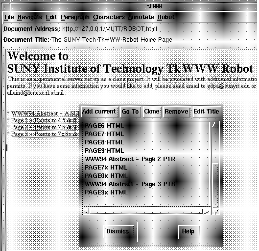

*with the Robot extension:* The tkWWW window running its web-crawler extension.  
Credit: Scott Spetka · [GPL](http://www.gnu.org/licenses/gpl.html) · [source](https://commons.wikimedia.org/wiki/File:TkWWW_Robot.gif)

## MacWWW (Samba)

Robert Cailliau, Nicola Pellow (CERN) · Classic Mac OS · [Wikipedia](https://en.wikipedia.org/wiki/MacWWW)

**Look:** Early Macintosh browser in classic System 6/7 windows.

| Version | Released | Notes |
| --- | --- | --- |
| first release | 1992-12 |  |

Fair-use screenshots on Wikipedia (linked, not copied):

- [MacWWWscreenshot.gif](https://en.wikipedia.org/wiki/File:MacWWWscreenshot.gif): MacWWW on classic Mac OS.

## NCSA Mosaic

National Center for Supercomputing Applications (NCSA) · Unix (X11/Motif), Windows, Classic Mac OS · [Wikipedia](https://en.wikipedia.org/wiki/Mosaic_(web_browser))

**Look:** Motif window with a row of text buttons (Back, Forward, Home, Reload, Open, Save, Clone, New Window, Close), Title and URL fields above the page, and an animated logo in the top-right corner. Images appear inline with the text.

| Version | Released | Notes |
| --- | --- | --- |
| 0.5 (X) | 1993-01-23 | First release. |
| 1.0 (X) | 1993-04-21 |  |
| 2.0 (X) | 1993-11-10 |  |
| 2.4 (X) | 1994-04-11 |  |
| 2.5 (X) | 1995-03-12 |  |
| 2.6 (X) | 1995-07-06 |  |

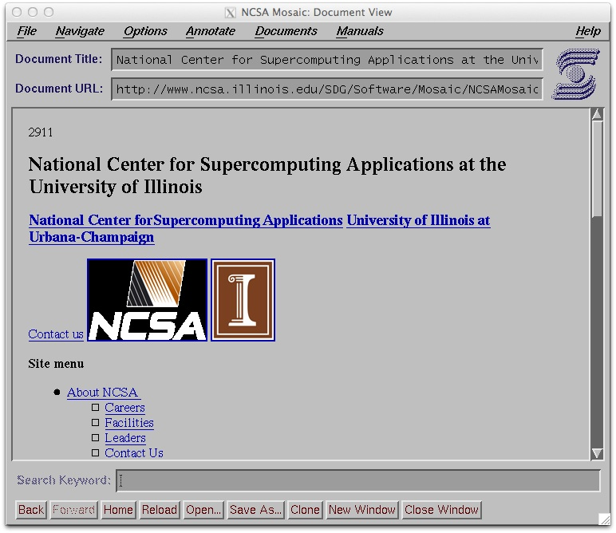

*Mosaic for X:* Main window with its button row, URL field and page.  
Credit: Charles Severance · [CC0](http://creativecommons.org/publicdomain/zero/1.0/deed.en) · [source](https://commons.wikimedia.org/wiki/File:NCSA_Mosaic_Browser_Screenshot.png)

Fair-use screenshots on Wikipedia (linked, not copied):

- [NCSAMosaic1.0Mac.png](https://en.wikipedia.org/wiki/File:NCSAMosaic1.0Mac.png): NCSA Mosaic 1.0 for Macintosh.

Try it: [oldweb.today: NCSA Mosaic 2 for Mac, in emulation](https://oldweb.today/?browser=nm2-mac)

Try it: [oldweb.today: NCSA Mosaic 3 for Mac, in emulation](https://oldweb.today/?browser=nm3-mac)

## Cello

Legal Information Institute, Cornell Law School · Windows 3.1, OS/2 · [Wikipedia](https://en.wikipedia.org/wiki/Cello_(web_browser))

**Look:** One of the first browsers for Windows 3.1, with a plain menu bar and toolbar over the page.

| Version | Released | Notes |
| --- | --- | --- |
| 0.1 beta | 1993-06-08 |  |

Fair-use screenshots on Wikipedia (linked, not copied):

- [Cello 2.0 (screenshot).gif](https://en.wikipedia.org/wiki/File:Cello_2.0_(screenshot).gif): Cello 2.0.
- [Cello main page.png](https://en.wikipedia.org/wiki/File:Cello_main_page.png): Cello showing a page.

## IBM WebExplorer

IBM · OS/2 · [Wikipedia](https://en.wikipedia.org/wiki/IBM_WebExplorer)

**Look:** Native OS/2 browser that came with OS/2 Warp 3.

| Version | Released | Notes |
| --- | --- | --- |
| first release | 1994 | Shipped with OS/2 Warp 3; Wikipedia's infobox lists 1995-11-27 and a last version 1.2 in 1998. |

Fair-use screenshots on Wikipedia (linked, not copied):

- [OS2 IBM WebExplorer.png](https://en.wikipedia.org/wiki/File:OS2_IBM_WebExplorer.png): WebExplorer on OS/2.

## Netscape (Mosaic Netscape, Navigator, Communicator)

Netscape Communications · Windows 3.1/95/NT, Classic Mac OS, Unix (many) · [Wikipedia](https://en.wikipedia.org/wiki/Netscape_(web_browser))

**Look:** 1.x–3.x: grey toolbar of large icon-and-label buttons, a Location field, a row of shortcut buttons to the maker's own pages, an animated logo at the top right, and a status bar with a progress meter and a security icon. 4.x (Communicator) restyled the toolbars, added a Personal Toolbar and collapsible toolbar tabs, and put a small component bar for the suite's other apps in the status bar.

| Version | Released | Notes |
| --- | --- | --- |
| 0.9 (Mosaic Netscape) | 1994-10-13 | First public beta. |
| 1.0 | 1994-12-15 | First non-beta release. |
| 1.1 | 1995-03 | Tables, background images and colours. |
| 1.22 | 1995-08 |  |
| 2.0 | 1995-09-18 | JavaScript, Java, plug-ins, frames; mail and news built in. (Date as listed by Wikipedia.) |
| 2.01 | 1996-03-18 |  |
| 3.0 | 1996-08-19 | LiveAudio/LiveVideo, HTML 3.2. 'Gold' editions added an editor. |
| 3.03 | 1997-07-31 |  |
| 3.04 | 1997-10-04 |  |
| 4.0 (Communicator) | 1997-06-11 | Became a suite: browser, mail, editor, groups, push channels. |
| 4.01–4.04 | 1997-06-18 to 1997-11-14 |  |
| 4.05–4.08 | 1998-04-02 to 1998-11-09 | 4.06 added the Flash plug-in and 'Smart Browsing'. 4.08 was the last for 16-bit Windows and 68k Macs. |
| 4.5 | 1998-10-19 |  |
| 4.51 | 1999-03-08 |  |
| 4.6 | 1999-05-18 |  |
| 4.61 | 1999-06-14 |  |
| 4.7 | 1999-09-30 | Last release of the decade. |

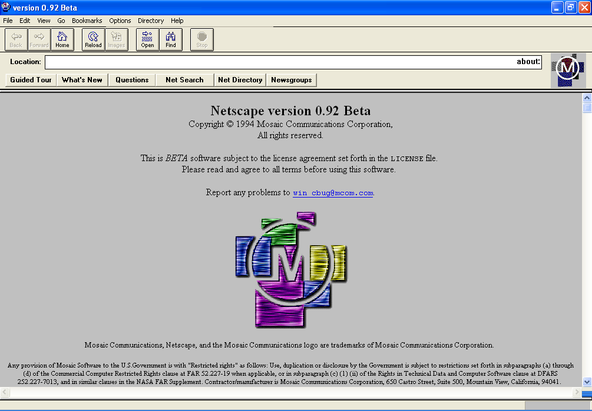

*0.9x (Mosaic Netscape):* About page of an 0.9x pre-release.  
Credit: Indolering · [CC0](http://creativecommons.org/publicdomain/zero/1.0/deed.en) · [source](https://commons.wikimedia.org/wiki/File:Netscape_0.92_Screenshot.png)

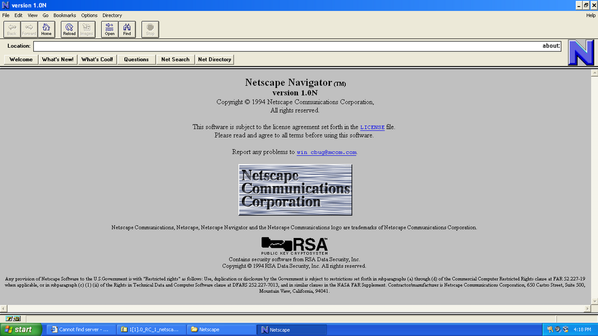

*1.0N:* The 1.0 "network release".  
Credit: Indolering · [CC0](http://creativecommons.org/publicdomain/zero/1.0/deed.en) · [source](https://commons.wikimedia.org/wiki/File:Netscape-1.0N.png)

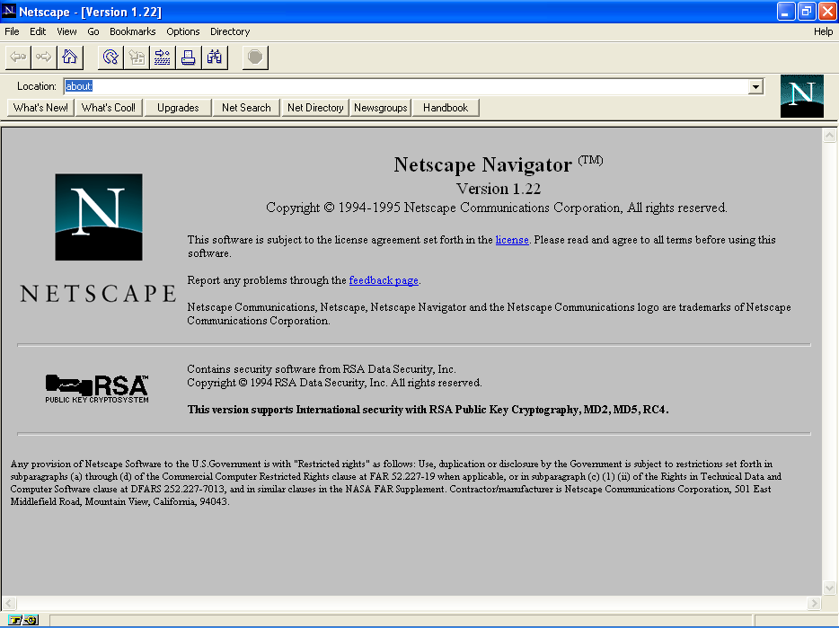

*1.22:* About page.  
Credit: Indolering · [CC0](http://creativecommons.org/publicdomain/zero/1.0/deed.en) · [source](https://commons.wikimedia.org/wiki/File:Netscape_Navigator_1.22_Screenshot.png)

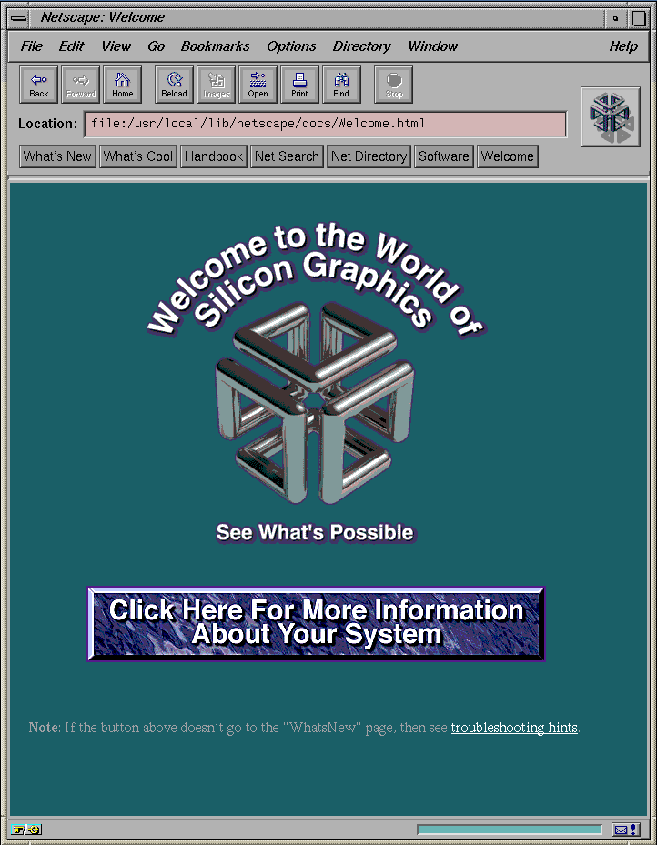

*2.01 (IRIX):* Unix (Motif) build on an SGI Indy.  
Credit: Aeroid · [CC BY-SA 4.0](https://creativecommons.org/licenses/by-sa/4.0) · [source](https://commons.wikimedia.org/wiki/File:Irix_Netscape_Welcome.png)

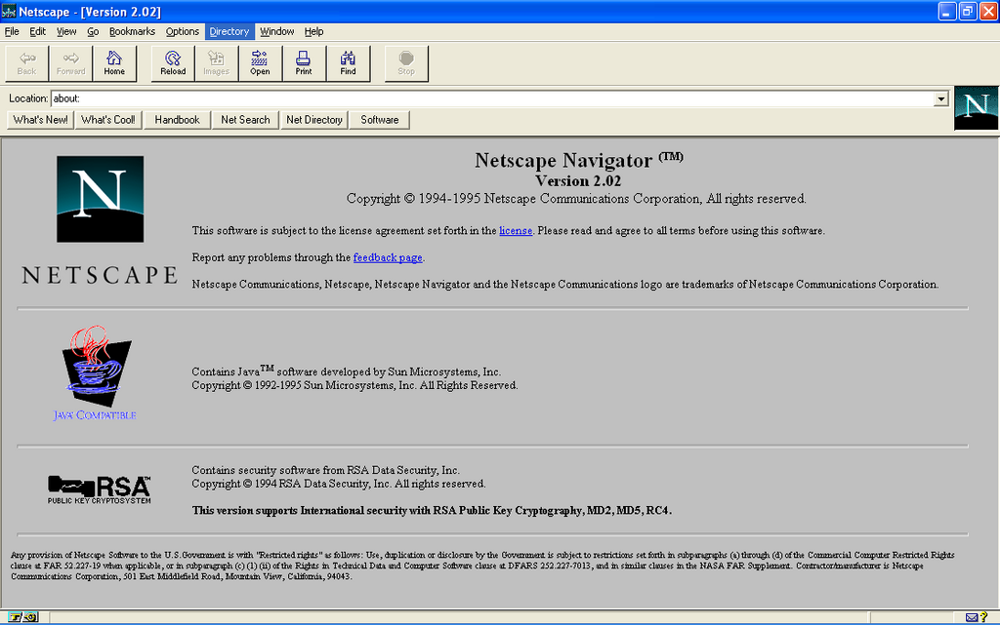

*2.02:* About page, Windows build.  
Credit: Indolering · [CC0](http://creativecommons.org/publicdomain/zero/1.0/deed.en) · [source](https://commons.wikimedia.org/wiki/File:Netscape_Navigator_2_Screenshot.png)

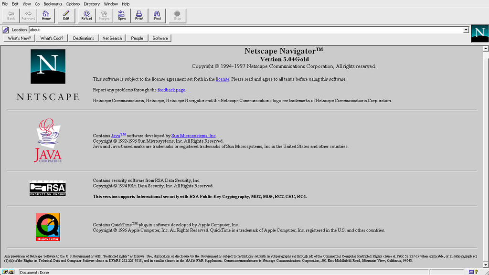

*3.04 Gold:* About page, Windows build (run under Wine). The Commons description says 3.02; the page itself says 3.04 Gold.  
Credit: Indolering · [CC0](http://creativecommons.org/publicdomain/zero/1.0/deed.en) · [source](https://commons.wikimedia.org/wiki/File:Netscape_Navigator_3_Screenshot.png)

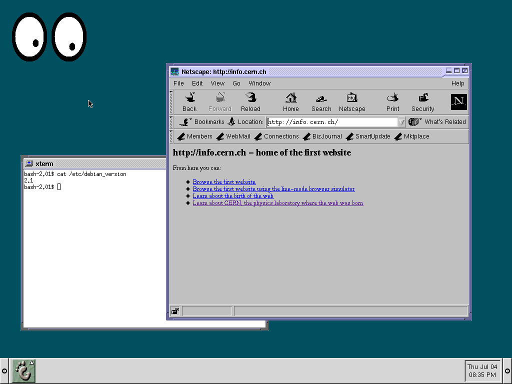

*4.x (Linux):* Communicator-era window on a Debian 2.1 (1999) desktop: toolbar, Location bar with What's Related, personal toolbar and status bar.  
Credit: 2204happy · [CC BY-SA 4.0](https://creativecommons.org/licenses/by-sa/4.0) · [source](https://commons.wikimedia.org/wiki/File:Debian-Slink.png)

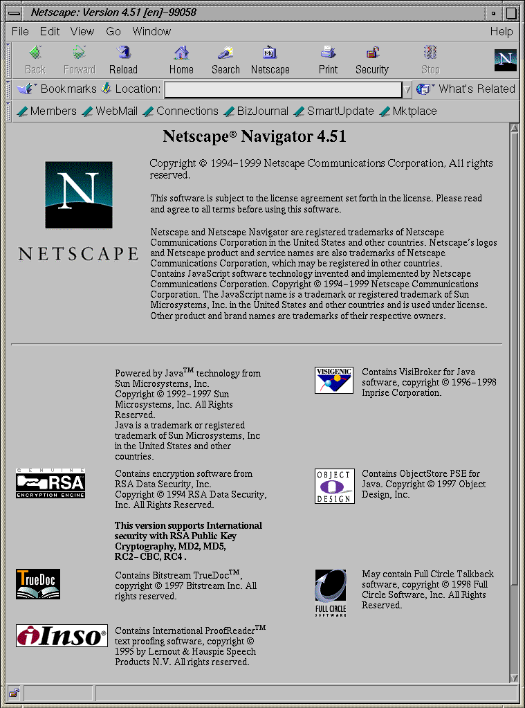

*4.51 (IRIX):* Communicator-era Unix build on an SGI Indy.  
Credit: Aeroid · [CC BY-SA 4.0](https://creativecommons.org/licenses/by-sa/4.0) · [source](https://commons.wikimedia.org/wiki/File:Irix_Netscape451.png)

Fair-use screenshots on Wikipedia (linked, not copied):

- [Mosaic Netscape 0.9 on Windows XP.png](https://en.wikipedia.org/wiki/File:Mosaic_Netscape_0.9_on_Windows_XP.png): Mosaic Netscape 0.9 (run on Windows XP).
- [Navigator 1-22.png](https://en.wikipedia.org/wiki/File:Navigator_1-22.png): Navigator 1.22.
- [Welcome to Netscape.gif](https://en.wikipedia.org/wiki/File:Welcome_to_Netscape.gif): A Netscape window showing its welcome page.
- [Apple Unix with Netscape.png](https://en.wikipedia.org/wiki/File:Apple_Unix_with_Netscape.png): Apple Unix with Finder, CommandShell and Netscape 3.01.

Try it: [oldweb.today: Navigator 4 on Windows, in emulation](https://oldweb.today/?browser=ns4-win)

Try it: [oldweb.today: Navigator 3 for Mac, in emulation](https://oldweb.today/?browser=ns3-mac)

Try it: [oldweb.today: Navigator 4 for Mac, in emulation](https://oldweb.today/?browser=ns4-mac)

## Arena

CERN / W3C; later Yggdrasil Computing · Unix (X11), Linux, NeXT · [Wikipedia](https://en.wikipedia.org/wiki/Arena_(web_browser))

**Look:** W3C's testbed for HTML 3 and CSS: a simple X window with a button bar, used to show off tables, maths and stylesheets.

| Version | Released | Notes |
| --- | --- | --- |
| 0.91 (first public) | 1994-10-24 |  |

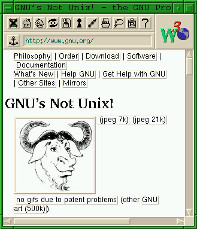

*W3C era:* The Arena window (image recovered from the Internet Archive).  
Credit: Remember the dot · [FAL](http://artlibre.org/licence/lal/en) · [source](https://commons.wikimedia.org/wiki/File:Arena_(web_browser)_screenshot.png)

## SlipKnot

MicroMind · Windows 3.1 · [Wikipedia](https://en.wikipedia.org/wiki/SlipKnot_(web_browser))

**Look:** Graphical browser for people with only a Unix shell account, fetching pages over a plain dial-up terminal session.

| Version | Released | Notes |
| --- | --- | --- |
| first release | 1994-11 |  |

Fair-use screenshots on Wikipedia (linked, not copied):

- [Slipknot browser.gif](https://en.wikipedia.org/wiki/File:Slipknot_browser.gif): SlipKnot on Windows 3.1.

## Opera (MultiTorg Opera)

Telenor research, then Opera Software · Windows, later others · [Wikipedia](https://en.wikipedia.org/wiki/History_of_the_Opera_web_browser)

**Look:** Several pages open as child windows inside one main window (MDI), with a 'hotlist' side panel, page zoom, and a download small enough for a floppy disk.

| Version | Released | Notes |
| --- | --- | --- |
| 1.0 (MultiTorg Opera) | 1995 | Internal release, shown in public in April 1995. |
| 2.0 | 1996 | First public release (shareware). |
| 3.0 | 1997-12-31 | First with JavaScript. |
| 3.5 | 1998 | CSS support. |

Fair-use screenshots on Wikipedia (linked, not copied):

- [MultiTorg Opera.png](https://en.wikipedia.org/wiki/File:MultiTorg_Opera.png): MultiTorg Opera, before version 2.0.
- [Opera 3.62.png](https://en.wikipedia.org/wiki/File:Opera_3.62.png): Opera 3.62 on Windows 9x.

## Internet Explorer

Microsoft · Windows 3.1/95/98/NT, Classic Mac OS, Solaris and HP-UX · [Wikipedia](https://en.wikipedia.org/wiki/Internet_Explorer_version_history)

**Look:** 1–2: a small Windows 95-style toolbar over the page. 3: large buttons in a rebar with Address and Links bands. 4: flat buttons that highlight on hover, a side Explorer Bar for search, favourites and history, Active Desktop and push channels. 5: address-bar autocomplete.

| Version | Released | Notes |
| --- | --- | --- |
| 1.0 (Windows) | 1995-08-24 | Part of the Plus! pack for Windows 95. |
| 1.5 | 1995–96 | Basic table display. Sources differ on the date. |
| 2.0 (Windows) | 1995-11-27 | Cookies, SSL, frames. |
| 2.0 (Mac) | 1996-04-23 |  |
| 2.1 (Mac) | 1996-08 |  |
| 3.0 (Windows) | 1996-08-13 | CSS, ActiveX, JScript; came with Windows 95 OSR2. |
| 3.0 (Mac) | 1997-01-08 |  |
| 3.01 (Mac) | 1997-05-14 |  |
| 4.0 (Windows) | 1997-09-22 | Shell integration, Active Desktop, channels. |
| 4.0 (Mac) | 1998-01-06 |  |
| 4.0 (Unix) | 1998-03-04 | Solaris and HP-UX. |
| 4.5 (Mac) | 1999-01-05 |  |
| 5.0 (Windows) | 1999-03-18 |  |

Fair-use screenshots on Wikipedia (linked, not copied):

- [Internet Explorer 1.0.png](https://en.wikipedia.org/wiki/File:Internet_Explorer_1.0.png): Internet Explorer 1.0.
- [Internet Explorer 2.PNG](https://en.wikipedia.org/wiki/File:Internet_Explorer_2.PNG): Internet Explorer 2.0.
- [Internet Explorer 3 on Windows 95.png](https://en.wikipedia.org/wiki/File:Internet_Explorer_3_on_Windows_95.png): Internet Explorer 3 on Windows 95.
- [Internet Explorer 4.png](https://en.wikipedia.org/wiki/File:Internet_Explorer_4.png): Internet Explorer 4.01 showing the Wikipedia main page.
- [Internet Explorer 4 for Solaris screenshot.png](https://en.wikipedia.org/wiki/File:Internet_Explorer_4_for_Solaris_screenshot.png): Internet Explorer 4 for Solaris.
- [Internet Explorer 5 on Windows 98.png](https://en.wikipedia.org/wiki/File:Internet_Explorer_5_on_Windows_98.png): Internet Explorer 5 on Windows 98.
- [Oe-Ie5-unix.jpg](https://en.wikipedia.org/wiki/File:Oe-Ie5-unix.jpg): Internet Explorer 5 and Outlook Express for UNIX.

Try it: [oldweb.today: Internet Explorer 5 on Windows, in emulation](https://oldweb.today/?browser=ie5)

Try it: [oldweb.today: Internet Explorer 4 for Mac, in emulation](https://oldweb.today/?browser=ie4-mac)

## Grail

Corporation for National Research Initiatives (CNRI) · Unix, Windows, Mac (Python/Tk) · [Wikipedia](https://en.wikipedia.org/wiki/Grail_(web_browser))

**Look:** Written in Python with Tk widgets; could run Python applets inside pages.

| Version | Released | Notes |
| --- | --- | --- |
| first public release | 1995-11 | Project started 1995-08. |
| 0.6 | 1999-04-01 | Last release. |

Fair-use screenshots on Wikipedia (linked, not copied):

- [Grail browser on Linux.png](https://en.wikipedia.org/wiki/File:Grail_browser_on_Linux.png): Grail on Linux.

## Oracle PowerBrowser

Oracle · Windows · [Wikipedia](https://en.wikipedia.org/wiki/Oracle_PowerBrowser)

**Look:** Windows browser bundled with a small personal web server and database tools.

| Version | Released | Notes |
| --- | --- | --- |
| first release | 1996 |  |

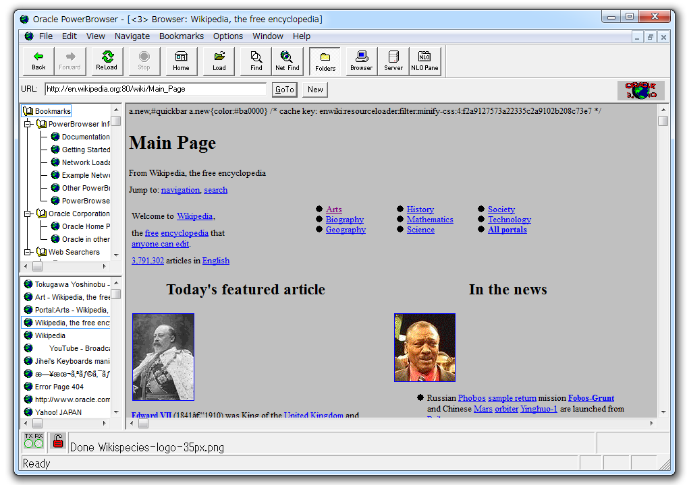

*1996:* Main window.  
Credit: Jihei · [CC BY-SA 3.0](https://creativecommons.org/licenses/by-sa/3.0) · [source](https://commons.wikimedia.org/wiki/File:Oracle_PowerBrowser.png)

## IBrowse

Stefan Burström and others · AmigaOS · [Wikipedia](https://en.wikipedia.org/wiki/IBrowse)

**Look:** Amiga browser built with the MUI toolkit.

| Version | Released | Notes |
| --- | --- | --- |
| 1.0 | 1996-07-28 |  |

Fair-use screenshots on Wikipedia (linked, not copied):

- [IBrowse Amiga.png](https://en.wikipedia.org/wiki/File:IBrowse_Amiga.png): IBrowse on AmigaOS.

## WebTV

WebTV Networks (Microsoft from 1997) · Set-top box on a TV · [Wikipedia](https://en.wikipedia.org/wiki/MSN_TV)

**Look:** Browsing on a television with a remote control or a wireless keyboard.

| Version | Released | Notes |
| --- | --- | --- |
| launch | 1996-09-18 |  |

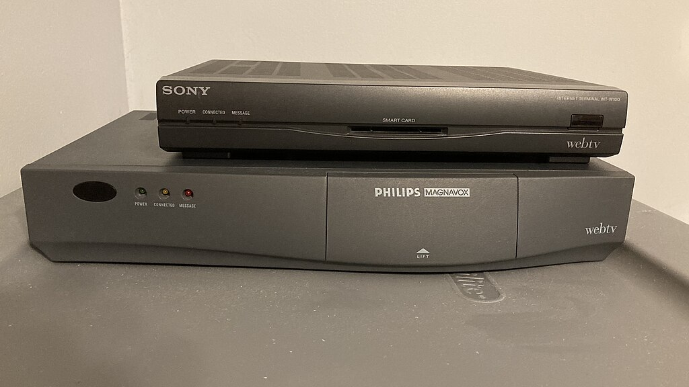

*1996 hardware:* Photo of the two launch set-top boxes (hardware, not the screen).  
Credit: Halen Martini · [CC BY-SA 4.0](https://creativecommons.org/licenses/by-sa/4.0) · [source](https://commons.wikimedia.org/wiki/File:WebTV_Launch_Units.jpg)

## Arachne

Michael Polák and contributors · DOS, later Linux · [Wikipedia](https://en.wikipedia.org/wiki/Arachne_(web_browser))

**Look:** Graphical browser for DOS that ran in display modes from CGA to VESA.

| Version | Released | Notes |
| --- | --- | --- |
| first release | 1996-12-22 |  |

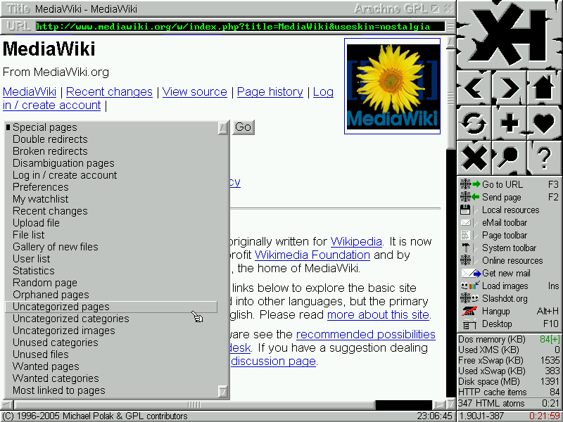

*later GPL build:* 800×600 VESA mode.  
Credit: Arachne contributors · [GPL](http://www.gnu.org/licenses/gpl.html) · [source](https://commons.wikimedia.org/wiki/File:Arachne_VESA_Mode.png)

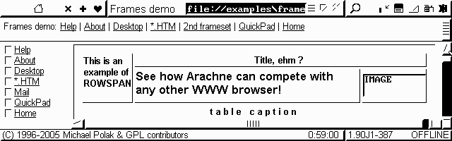

*later GPL build:* 640×200 monochrome CGA mode.  
Credit: Arachne contributors · [GPL](http://www.gnu.org/licenses/gpl.html) · [source](https://commons.wikimedia.org/wiki/File:Arachne_CGA_Mode.png)

## HotJava

Sun Microsystems · Solaris, Windows, any Java platform · [Wikipedia](https://en.wikipedia.org/wiki/HotJava)

**Look:** Browser written in Java, and the first to run Java applets.

| Version | Released | Notes |
| --- | --- | --- |
| 1.0 | 1997-03-24 | Earlier alpha/beta versions from 1995. |

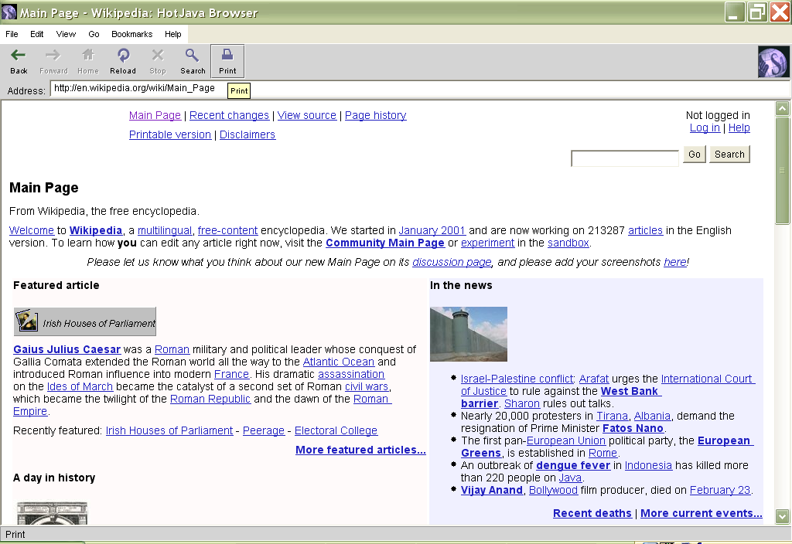

*3.0:* Main window.  
Credit: User Optim on en.wikipedia · [CC BY-SA 4.0](https://creativecommons.org/licenses/by-sa/4.0) · [source](https://commons.wikimedia.org/wiki/File:MainPage-HotJava3-Optim.png)

## Links

Mikuláš Patočka · Unix-like, OS/2, DOS, Windows · [Wikipedia](https://en.wikipedia.org/wiki/Links_(web_browser))

**Look:** Text browser with pull-down menus and real table and frame layout in the terminal.

| Version | Released | Notes |
| --- | --- | --- |
| first release | 1999 |  |

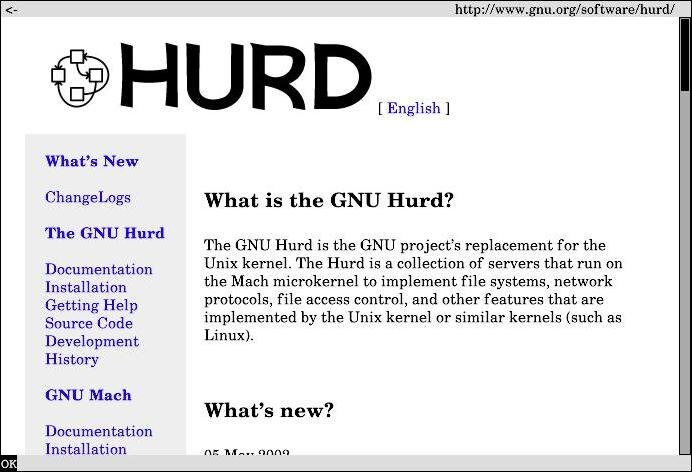

*2000s build:* Text-mode interface.  
Credit: Gürkan Sengün · [Public domain](https://commons.wikimedia.org/wiki/File:Webbrowser_Links.jpg) · [source](https://commons.wikimedia.org/wiki/File:Webbrowser_Links.jpg)

## iCab

Alexander Clauss · Classic Mac OS · [Wikipedia](https://en.wikipedia.org/wiki/ICab)

**Look:** Mac browser that ran on old 68k Macs and showed a smiley face for valid HTML (a frown for errors).

| Version | Released | Notes |
| --- | --- | --- |
| first preview | 1999-02-17 |  |

## No screenshot found yet

Browsers of the decade that still need a screenshot. A freely licensed one could be added here.

| Browser | First release |
| --- | --- |
| [MidasWWW](https://en.wikipedia.org/wiki/MidasWWW) | 1992-11-16 |
| [MacWeb](https://en.wikipedia.org/wiki/MacWeb) | 1994-05-31 |
| [OmniWeb](https://en.wikipedia.org/wiki/OmniWeb) | 1995-03-17 |
| [w3m](https://en.wikipedia.org/wiki/W3m) | 1995 |
| [Cyberdog](https://en.wikipedia.org/wiki/Cyberdog) | 1996-02 (beta) |
| [Amaya](https://en.wikipedia.org/wiki/Amaya_(web_editor)) | 1996-07 |
| [AWeb](https://en.wikipedia.org/wiki/AWeb) | 1996 |
| [Voyager (Amiga)](https://en.wikipedia.org/wiki/Voyager_(web_browser)) | 1990s |

## References

- [oldweb.today: old browsers running in emulation, in your own browser](https://oldweb.today/)
- [CERN's rebuild of WorldWideWeb](https://worldwideweb.cern.ch/)
- [Wikipedia: History of the web browser](https://en.wikipedia.org/wiki/History_of_the_web_browser)
- [Wikipedia: List of web browsers](https://en.wikipedia.org/wiki/List_of_web_browsers)
- [Wikimedia Commons: Screenshots of web browsers](https://commons.wikimedia.org/wiki/Category:Screenshots_of_web_browsers)

## Updating this catalog

1. Find a screenshot on [Wikimedia Commons](https://commons.wikimedia.org/) and check its file page:
   copy it into `images/` only if it is public domain or under a free licence
   (CC0, CC BY, CC BY-SA, GPL, FAL and similar). Anything marked fair use or
   non-free goes in `linked` instead.
2. Add it to `catalog.json` with its author, licence, licence URL and source page.
3. Run `python3 render.py` to regenerate this file.
